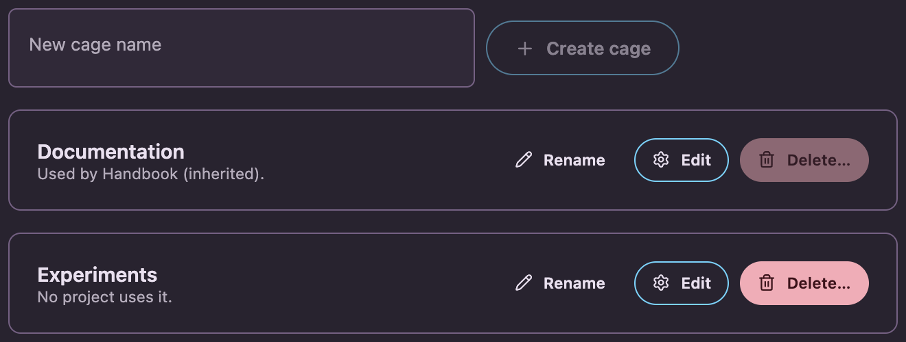

A **cage** is the sandbox config of a [project](/projects/): its mounts, its [network policy](/network/), its
credentials and its agents. A cage starts as a Linux microVM with its own kernel (microsandbox, libkrun on
Hypervisor.framework). The VM is the unit of isolation.

## The cage list

**Cages** at the bottom of the rail shows all cages, with the projects that use each one.

- **Create cage** adds a cage with no mounts, rules or agents.
- **Rename** changes the name of the cage. The projects keep their names.
- **Duplicate** adds a copy named "<name> copy" with the mounts, network rules, agents and settings of the cage. The copy
  has no credential values of its own: set them again in **Edit** or in the Network tab of a project that uses the copy. Credentials
  from the [credential library](/network/#shared-credentials) keep their shared value.
- **Edit** shows the mounts, the agent settings and the [network policy](/network/) of the cage. Edit the default,
  Offline, the service on this Mac, the rules, their methods and credentials, and the profiles here, also when no
  project uses the cage. A network edit goes to each running VM of the cage and applies to the next request, with no
  restart. The network test, the requests that wait for an answer and the network activity are in the **Network** tab
  of a project, because they belong to a running VM.
- **Delete** removes the cage, its own credential values and the agent state of all its VMs. Values from the
  [credential library](/network/#shared-credentials) stay. A project that kept an own VM
  of the cage after a cage change goes back to the shared VM. You cannot delete a cage that a project uses, that is the
  default cage of a workspace, or whose VM runs. The button then shows the reason as a tooltip.

The ⌘K menu has **Cages**, and **Edit cage X** and **Duplicate cage X** for each cage.

When you delete a project that is the only user of its cage, **Settings > Delete project** also offers **Delete with
cage X**. This deletes the project, then the cage and its credential values. A cage that is the default cage of a
workspace, or whose VM runs for a different project, is not offered.

## Attach or inherit

In **Settings** of a project, **Cage** selects the cage of the project. **Inherit from workspace** uses the default
cage of its workspace. Set the default cage of a workspace with **Default cage…** in the menu of the workspace. A
project that inherits, in a workspace with no default cage, has no cage: its Mac shells and its
[agents](/agents/#agents-with-no-cage) run on your Mac, and nothing isolates them. Its tasks do not run, because tasks
need a cage.

A change of the cage applies at the next start. A VM that runs keeps running with its old cage until it stops. The
project page then shows "The VM runs cage X; restart to use Y". If the project has no cage now, the page still shows
**Stop cage** for the old VM.

The project row in the sidebar shows a restart button (pending cage change) when its VM runs a different cage or an
older config of its cage. Click it to restart the VM. A shared VM asks first.

Edits always go to the current cage of the project: mounts, network rules, offline, logins, agents and settings. A VM
that runs with an old cage does not get these edits: they apply after the restart. The VM status, **Start** and **Stop**, the network test and
the network activity apply to the VM that runs for the project.

## Projects in one VM

All projects of a cage share its VM. The projects in one VM can read and write each other's folders: put a project
in its own cage if it must not see the others.

- **Path rule.** A VM with one project mounts its folder at `/workspace`. A VM with more projects mounts each folder
  at `/workspace/<slug>`. The slug is the folder name in kebab case. It is fixed when you create the project: a
  rename does not change it. A harness folder or a task working dir below `/workspace` moves with its project, so
  `/workspace/src` becomes `/workspace/<slug>/src`.
- **Add a project to a running VM.** A start of a project whose cage runs for other projects asks first: "Restart
  cage X to add Y?" After the restart, the VM terminals of the other projects open again. Their running tasks are
  cancelled. A terminal that does not open again stays closed, and a notice names it. If the VM had one
  project, its folder moves from `/workspace` to `/workspace/<slug>`, and its agents do not find their history of the
  old path. If the VM or its projects changed while the question was open, the restart is refused: try again.
- **Stop.** A stop of a VM with other projects names them and asks first. The stop ends the VM for all of them. If
  the VM or its projects changed while the question was open, the stop is refused: try again.
- **Running tasks.** Each of these questions also names the running tasks that the stop or restart cancels. A stop
  or restart of a VM with one project asks first only when that project has running tasks, and names them.
- **Terminals after a restart.** A VM terminal opens again at the size that it had. An agent that had a conversation
  continues it, with its continue option (`claude -c`, `codex resume --last`, `pi -c`, `gemini --resume latest`,
  `agy -c`). An agent whose folder moved, or that had no conversation yet, starts a new session. Codex, Gemini CLI and
  Antigravity CLI do not report their turns to zwinger, so they always continue when their folder stays the same. If
  such a continue finds no conversation and the agent exits at once, the agent starts a new session in the same
  terminal.
- **Restart after a cage edit.** **Restart** on the project page restarts the VM with all its projects. It asks first
  when the VM has other projects. Their VM terminals open again, and their running tasks are cancelled. After a
  change of the project's cage, **Restart** stops the old VM and starts the new cage for this project only.
- **Checks.** The start checks each project folder: it must not overlap a mount or a different project folder of the
  VM, it must be the same folder that you added, and it must not overlap the zwinger data folder. No mount of the
  cage may overlap the zwinger data folder (the app data folder or `~/.zwinger`). zwinger finds this folder again at
  each check, so a `~/.zwinger` link that you make later is also seen.
- **Old mount of the data folder.** An old config can have a mount that overlaps the zwinger data folder. This mount
  blocks the start of the cage and the addition of new mounts. The error names the cage and the mount. To remove the
  mount, click its X button in **Edit > Mounts**, then try again.
- **Hot mount.** A project cannot join a running VM with no restart yet.
- **Checks across VMs.** A project folder also must not overlap the folder of a project of the same cage that runs in
  a different VM, such as its own VM.
- **Projects of other cages.** A folder of this VM must not be inside, or contain, a writable folder of a project of
  a different cage. The same folder is allowed: you can mount the folder of another project, also as writable.

A start of a stopped VM boots it with only the project that starts it. A project that you delete must not run in a
VM with other projects: stop that VM first.

The project row in the sidebar shows the cage icon with the number of projects of a shared VM. Its tooltip names
them.

## Own VM

A project can run in a VM of its own instead of the shared VM of its cage. Use **Use own VM** in the menu of the
project row. **Use shared VM** puts it back. The own VM uses the same cage: the same mounts, network policy,
credentials and agents. A cage edit goes to all VMs of the cage. A network edit and a Claude Code or Codex edit reach
each running VM at once. A mount, pi or Gemini CLI edit waits for the restart of each VM.

- **Names.** The shared VM has the id of its cage as its key. An own VM gets the key `<cage id>-<n>`, with the lowest
  free number from 2. The VM name is `zwinger-<key>`. The network events, the start progress and the guest logins
  are per VM.
- **Agent state.** An own VM has its own agent state: its agents do not see the history or the guest logins of the
  shared VM. The state stays while the project keeps its own VM. **Use shared VM**, and a delete of the project,
  delete the state of the own VM. If zwinger cannot delete it, you see the folder: delete it by hand. zwinger does not
  give that key to a new own VM while the folder is there. A new own VM always starts with an empty state.
- **Where the state is.** The agent state of each VM is in `projects/<key>` in the app data folder. Earlier builds
  kept it in `shields/<key>`. At start, after zwinger stopped the VMs of the earlier run, it moves each old folder to
  the new place. If a folder cannot move, for example because `projects/<key>` already has files, a notice names the two
  folders: move or delete one of them, then restart zwinger. Until the old folder is gone, that VM does not start, and
  zwinger does not delete or change its state. The move also waits while a VM starts, runs or stops: the next cage
  start after that VM stops moves the state. If zwinger could not stop the VMs of an earlier run in an old runtime
  home, the move waits. Deletes, resets and key releases of agent state also wait while an old runtime home is not
  reaped, also for state that already moved. To try again, start a cage or restart zwinger. zwinger never uses a
  `shields`, `projects` or `projects/<key>` that is a link: move or delete the link, then restart zwinger.
- **Stopped VM.** A stopped own VM keeps its network log until the project leaves it.
- **Running VM.** If the VM of the project runs, the change asks first. A VM with this project only stops. A shared VM
  with other projects restarts without this project: their VM terminals open again, and their running tasks are
  cancelled. The new VM starts with the next start of the project.
- **Cage change.** A project with its own VM keeps it after a change of its cage. At the next start, it gets a new key
  of the new cage, and the state of the old own VM is deleted.

The project row shows a box icon when the project has its own VM. The tooltip of the cage icon says "shared VM" or
"own VM".

## What the cage sees

A cage start boots the VM with the project folders, the mounts and the [network policy](/network/). Nothing else from
the Mac is in the cage:

- no environment variables of the Mac
- no credentials
- no home folder of the Mac

Credentials and logins from the Mac are never in the VM. The proxy of the cage adds them to the requests to their
hosts only.

## Resources

**Settings > Resources** of a project, or **Cages > Edit**, sets the CPUs and the memory of each VM of the cage: its shared VM and the own VMs of its
projects.

- **CPUs**: 1 to 8. The default is 1.
- **Memory**: 512 to 8192 MiB. The default is 512 MiB.

zwinger refuses a value outside these bounds and keeps the old value. The cage value replaces the default of the VM
runtime.

Below the fields, zwinger shows the CPUs and the memory of your Mac. It shows a warning when a value can prevent a VM
start:

- The CPUs are more than the logical CPUs of your Mac.
- The memory is more than the memory of your Mac minus 2 GiB, which macOS and zwinger need.

The warning does not block the save. zwinger does not add up the values of VMs that run at the same time.

For each running VM of the cage, the shared VM and the own VMs, zwinger also shows its actual use: the CPUs in use
(1.0 is one CPU fully in use) and the memory in use, of the values that the VM started with. The VM runtime measures
it each second. zwinger reads it every 3 seconds, only while the Resources card is open and the window is visible. A
VM that just started shows no use until its first measurement.

The next start of a VM applies a change. A running VM keeps its values until it restarts, and its status shows that
a restart is pending.

## Published ports

A server that runs in the VM, for example a dev server on port 3000, is not reachable from the Mac. **Settings >
Published ports** of a project, or **Cages > Edit**, publishes a guest port on this Mac:

1. Type the **Guest port**, the port where the server listens in the VM. The server must listen on `0.0.0.0` or on
   the VM's address, not only on `127.0.0.1` of the VM.
2. Optional: type the **Port on this Mac**. Empty means the same port as the guest port.
3. Click **Publish**. The new port is off.
4. Turn the port on, then restart the VM.
5. Click **Open** to open `http://localhost:<port>` in your browser.

:::caution
A published port listens on `127.0.0.1` only, so other computers cannot connect. But each app and each user on this
Mac can connect, and so can web pages in your browser. Turn on only a server that you trust, and turn the port off
when you do not use it. A port that you turn off stays open until the VM restarts.
:::

- A port is off or on. A new port is off. Off keeps the port in the list.
- A cage has at most 16 ports. A guest port and a port on this Mac can each occur once in a cage.
- zwinger refuses to save a port on this Mac that a different program uses.
- The next start of a VM applies a change. A running VM keeps its ports until it restarts: a port that you turn off
  shows "still published until the VM restarts".
- At the start, zwinger skips a port that is now in use and shows a notice. The VM starts without that port. When
  projects of one cage have their own VMs, only the first VM that starts gets the port.
- The port closes when the VM stops.
- The traffic does not go through the proxy of the cage. It is not in the network activity, and Offline and the rules
  do not apply to it.

The map shows each published port as an edge from `localhost:<port>` on the Mac side to the port in the cage. The
edge is active while the VM publishes the port.

## Terminals in the cage

A VM shell (⌘⇧T) and an agent session (⌘P) run in the cage. A VM shell starts in the project's folder in the VM
(`/workspace`, or `/workspace/<slug>` in a shared VM). An agent session starts in the harness folder of the project if
it has one, else in that folder. A Mac shell (⌘T) runs on the Mac, not in
the cage, and has no sandbox. A cage stop ends the VM shells and the agent sessions, but not the Mac shells.

The effective cage sets where an agent opens: a project with a cage opens the agent in the cage, and a project with no
cage opens the agent on your Mac. A VM that still runs with an old cage does not count. An agent with no cage has no
bypass option, no credentials, no proxy or CA environment variables and no state-folder override. zwinger shows a
warning before each open, and the terminal tab shows a no-cage icon and no status glyph. It can read all your files,
including the vault file. See [Agents with no cage](/agents/#agents-with-no-cage).

## Start and stop

You start and stop the VM of a project: the shared VM of its cage, or its own VM. A start shows its phases: vault, prepare, proxy, boot, guest and wrappers. The
status of a starting cage names the current phase. **Settings > Last start** of the project shows the time of each
phase. If the guest Node check fails, zwinger cancels the remaining guest checks and stops the VM.

**Settings > Start trend** shows the total time of the last 10 successful starts of the VM, oldest first, also when
the VM is stopped. Each start shows if it was slower, faster or the same as the start before. Failed and cancelled
starts are not kept. The trend is per VM: projects that share a VM share its trend, and an own VM has its own trend.
The trend stays after you quit zwinger. Each total shows to the millisecond. **Cages > Edit** shows the trend of the
shared VM of the cage. If you remove the cage of a project while its VM runs, Settings still shows the last start and
the trend of that VM.

A start mounts the folder of the [agent runtimes](/agents/#runtimes). A runtime that you install later is in each
running cage at once, with no restart.

## Storage

zwinger keeps its VM runtime in `~/.zwinger/microsandbox`. Your projects, preferences and agent runtimes are in
`~/Library/Application Support/com.driif.zwinger`.

The path of the runtime folder must be short, because macOS limits the length of a socket path. If your user name is
longer than 22 bytes, the "VM folder" check fails at start.

Earlier builds of zwinger used other folders. **Settings > Storage** shows them with their size and can remove the data
of zwinger from them.

**Unused VM folders.** Each VM has an agent state folder (`projects/<VM key>`), a wrapper folder (`bin/<VM key>`) and
a profile folder (`profiles/<VM key>`) in the app data folder. An interrupted removal of a project or a cage can leave
them. **Settings > Storage** lists each VM key that no project, cage or VM uses, with the size of its folders. Select
the keys, then click **Remove selected** and confirm. The agent history in these folders is lost.

- zwinger never lists or removes a link, or a VM key whose old state in `shields/<VM key>` is not moved yet.
- A key that a project, a cage or a VM took since the list showed it stays.
- While zwinger could not stop the VMs of an earlier run, the removal is refused: start a cage or restart zwinger,
  then try again.
