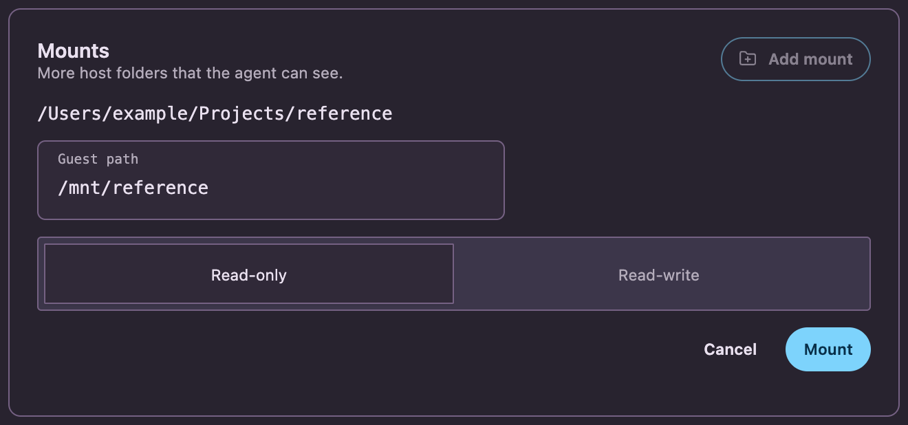

A **project** is one folder on your Mac and its configuration: the mounts, the network policy, the terminals, the
tasks and the agents from your Mac. A project uses a [cage](/cages/): its own cage, or the default cage of its
workspace. The project folder is mounted read-write at `/workspace` in the cage, or at `/workspace/<slug>` when other
projects share the VM ([Projects in one VM](/cages/#projects-in-one-vm)). While the VM runs, **Settings**, the map and
**Agent starts in** on the project page show the path that the VM uses. A project with no cage opens Mac shells only.

You can create, rename and delete projects. Use ⌘N to create a project. If you rename a project to an empty name,
it gets the name of its folder again. A rename does not rename the cage. A delete stops the VM of the project and keeps
its cage: delete the cage in the [Cages](/cages/#the-cage-list) view. If the VM also runs other projects, stop it
first.

A new project in a workspace with a default cage uses that cage. In a workspace with no default cage, it gets a new
cage with the name of the project.

## Workspaces

The rail shows your projects in **workspaces**. In the rail, a project is a **session**. Each session is in one
workspace. The tree is workspace → session → Terminals and Tasks. Use the Up and Down arrow keys to move between
visible rows. A ring marks the row that has keyboard focus.

- At the first start, one workspace with the name "Workspace" holds all projects.
- **New workspace** at the bottom of the rail adds an empty workspace.
- To rename a workspace or a session, double-click its row, or use **Rename** in its menu (right-click or the **…**
  button). The name becomes a field in the row. Press Enter or click outside the field to save the name. Press Escape
  to cancel. An empty name gives a workspace the name "Workspace" again.
- A menu closes when you select its **…** or chevron button again, press Escape, click outside it, or move the focus
  out of it, for example with Tab. Escape and the button put the focus back on the row or button that opened the menu.
- **Copy path** in a session menu, a launch menu or the command menu copies the project folder. A short message
  names the project and the path, and goes away after two seconds. If the copy fails, the error shows instead. A new
  copy removes the message of the earlier copy. Only the result of the last copy shows.
- You can delete only an empty workspace. The last workspace cannot be deleted.
- **Default cage…** in the menu of a workspace sets the cage of the sessions in it that inherit their cage. A session
  row shows a cage icon when the session has a cage. Its tooltip names the cage, with "(inherited)" if the cage comes
  from the workspace, and says if the session uses the shared VM of the cage or its own VM.
- **Use own VM** in the menu of a session runs it in a VM of its own, with the same cage. **Use shared VM** puts it
  back in the shared VM of its cage. If its VM runs, zwinger asks first. See [Own VM](/cages/#own-vm).
- Drag a workspace to change the order of the workspaces. Drag a session to change its place or to move it to a
  different workspace. You can also drop a session on a collapsed or empty workspace. The workspace then expands.
- A session that inherits its cage gets the default cage of its new workspace. If its VM runs in a different cage,
  the rail asks: **Restart now** stops the VM and starts the new cage, **At next start** keeps the VM until it stops,
  and **Cancel** puts the session back. Until the restart, the project page edits the new cage and shows the state of
  the old VM.
- With the keyboard, press Space to pick up a row, the Up and Down arrow keys to move it, and Space to drop it. Escape
  cancels the move. Each arrow key moves a session one row. At the border of its workspace, the session goes to the
  end of the workspace above or to the start of the workspace below. A collapsed workspace expands. A workspace moves
  one place for each arrow key.
- If the sidebar changed during a drag, zwinger shows "The sidebar changed. Try again." and shows the saved order.
- A terminal stays in its session. You can change only the order of the terminals in a session.
- Click a session to open its terminal view.
- Drop a folder from Finder on a workspace or a session row to create a project in that workspace. A folder dropped
  on empty rail space goes to the first workspace. A Terminals or Tasks row, a terminal row and a task row do not
  accept a folder. While you drag the folder, a dashed outline shows the row or the rail space that receives it. A file
  gets no outline. A duo round folder gets no outline either: it opens its room wherever you drop it.

zwinger saves the workspaces in `workspaces.json`, the projects in `sessions.json` and their cage settings in
`cages.json`, all in the app data folder. A start after an update from an older version converts `projects.json` to
the two new files once and keeps `projects.json` unchanged.

## Mounts

A mount is an extra folder on your Mac that you add to a project. It has an absolute path in the cage. This path must
not overlap `/workspace`. A mount is read-only by default.

A project folder or a mount cannot contain the zwinger data folder or `~/.zwinger`, and cannot be inside them. For
example, `~`, `~/Library` and `/` are refused. zwinger compares the real paths, after it follows symlinks. It checks
this when you create a project, when you add a mount and at each cage start.

zwinger keeps the identity of the project folder and of each mount. Each cage start checks them. If a folder changed
(for example, another folder now has the same path), zwinger does not start the cage. If a folder was missing, you
must confirm it on the project page before the next start.

## Terminals

A project has three kinds of terminal:

| Kind | Where it runs | Folder |
|---|---|---|
| Mac shell | On the Mac, with no sandbox. It does not need a cage start. | The project folder |
| VM shell | In the cage | `/workspace`, or `/workspace/<slug>` in a shared VM |
| Agent session | In the cage | The [harness folder](/agents/), else the VM shell's folder |

The tree shows all terminals of a project in one Terminals group. Drag a terminal to change the order. zwinger saves
the order.

- A terminal that has no process is **dormant**. This occurs after a cage stop or an app restart. **Open** starts a
  new process in the same place.
- When a process exits, its terminal keeps the last screen and shows the exit code next to **Open**.
  You can scroll, select and copy the output. If the pane gets smaller, scroll to see the full screen.
  **Open** starts a new process with an empty screen. After an app restart, the terminal is dormant again.
  Stopping the cage also makes a VM terminal dormant.
- A cage stop does not end a Mac shell. A project delete and the app exit end it.
- Only **Close** in the tree removes a terminal and ends its process.

A terminal's name is its kind and number, for example "Mac shell 2". When the shell or terminal app sets a window title
(OSC 0 or OSC 2), the tree row and the pane header show that title. The two labels change together. The title stays
with its process: an empty title, an exit, a reopen or a close shows the name again. The actions of the row and
the pane keep the name, for example "Actions for Mac shell 2". A long title is shortened to the width of the row
or header. Point to the title to read all of it.

zwinger keeps the last 1 MiB of output of each terminal. When you show the terminal again, for example after a window
reload, you see that output.

## Panes

The terminal view of a project can show terminals side by side. A split goes right (⌘D) or down (⌘⇧D) and opens a Mac
shell in the same folder. Any kinds of terminal can be in the same layout. zwinger saves the layout per project and
restores it after a restart. Each pane header shows where its terminal runs. **Mac** means the shell or agent runs
directly on your Mac. **VM** means it runs inside the cage. The badge also appears when the terminal is dormant.
In a narrow pane, select **…** in its header to split the pane, open its folder in your editor, or hide the pane.
Click a pane header, for example its name or badge, to focus that pane. The keys then go to its terminal, and the
editor commands and pane shortcuts use that pane. The buttons in the header do their own action and do not move the
focus.

After the name or title, the pane header shows the current folder of the terminal. A Mac folder below your home folder
starts with `~`. A VM terminal shows its folder in the VM, for example `/workspace/src`. A long folder is shortened in
the middle. Point to it to read the full path. The folder follows `cd`: a Mac shell's folder comes from macOS, and a
VM shell's folder comes from the report at each prompt. A new terminal shows its start folder until the first report.
When the folder is unknown, the header shows no folder. A narrow pane does not show the folder on the screen. Point
to the name to read the title and the full folder. Assistive technology also reads the full folder.

When you close a pane, the terminal is hidden but continues to run. A hidden terminal releases its WebGL context.
When you show it again, it redraws its output and uses WebGL if available. To end its process, use **Close** in the tree.

## Search in a terminal

Press ⌘F in a terminal to search its output, including the scrollback. The search field opens at the top right of
that pane. The keys do not go to the shell, and the other panes do not change. The search ignores case.

- Type to find the matches. All matches get an outline, and the current match is selected.
- Press Enter, or select the down arrow, to go to the next match. Press ⇧Enter, or select the up arrow, to go to the
  previous match.
- The field shows the number of the current match and the number of matches, for example "2 of 5". It shows
  "No matches" when there are none. At 1000 or more matches, it shows "1000+". New output updates the count.
- Press Escape in the search, or select **×**, to close the search. The outlines and the selected match go away and
  the focus goes back to the terminal.
- In a narrow pane, the search controls go on more than one line.

## Editors

zwinger finds the editors on your Mac (Zed, VS Code, Cursor and others) in `/Applications`, `~/Applications` and
`/Applications/Setapp`. Turn editors on and select a default in **Settings > Editors**.

A project can use a different editor. Select it in the **Editor** field in the project's **Settings** tab. **App
default** removes the project's editor, and the project then uses the app default. When the project's editor is off or
not installed, the project uses the app default. The field then shows the editor as **(not available)**, so you can
see it and remove it. The project keeps the editor, and uses it again when it is available.

**Open in editor**, the editor button, the pane menu and the default item of the command menu open the project's
default editor. They do not change a saved editor. When you select a specific editor from a menu, it becomes the
default: in a project with its own editor, for that project only, else for the app. zwinger saves it only when that
editor opened. If you change the editor settings while the editor opens, your change stays and the selection is not
saved. If the editor is gone, zwinger opens the default editor, tells you, and keeps the saved editors.
When the editors on your Mac changed and a different editor opens than the one shown, a notice names the two editors.

**Open in editor** (⌘⇧E) opens the project folder, or the current folder of the current terminal. In a VM shell, a
folder below a project folder of the VM or below a mount opens as its folder on the Mac. Other folders open the project folder.

The command menu names the folder that opens, for example **Open ~/dev/app/src in Zed**. When the terminal's folder
is not on the Mac or is unknown, it names the project folder and the reason, for example **Open project folder ~/dev/app
in Zed (VM folder /etc is not on the Mac)**. zwinger reads the folder again when you open it. While **Cages**, a round
folder room or a different screen covers the terminals, the command menu and ⌘⇧E open the project folder.

A VM shell starts in bash. When you install zsh or fish in the VM and start it from the VM shell (for example `zsh`
or `exec fish`), it also reports its folder at each prompt, and Open in editor follows `cd`. The VM does not need
zsh or fish when the project starts. zwinger does not change your shell config files. It adds files of its own, and
one line to the system zshenv:

- zsh: zsh reads your `.zshenv`, `.zprofile`, `.zshrc` and `.zlogin` as usual, from your `ZDOTDIR` or your home
  folder. zwinger adds its prompt hook after your last startup file, so a `precmd_functions=(...)` in your `.zshrc`
  keeps it. To start zsh, the VM shell gives zsh a zwinger folder as `ZDOTDIR`, and zsh then puts your own
  `ZDOTDIR` back. The first interactive zsh also adds one line to the system zshenv (`/etc/zsh/zshenv`, or
  `/etc/zshenv` if there is no `/etc/zsh`), so a zsh that you start from a zsh also reports its folder. The line
  remains in that VM. On Debian and Ubuntu, a zsh upgrade can ask how to handle the changed file. If the file
  does not exist or you cannot write it, only a zsh that starts from bash reports its folder. `zsh -f` skips your
  startup files and does not report its folder.
- fish 3: zwinger adds `/etc/fish/conf.d/zwinger.fish`. fish packages that use `/etc/fish` read it (Debian, Ubuntu,
  Alpine and others). A fish that you build with a different prefix does not read it. fish 4 reports its folder
  itself, and zwinger adds no second report.

Your prompt and your own prompt hooks stay as they are.

## Map

The project overview (⌘1) shows a map of the project: the folders, the mounts, the hosts and the agent profiles. You
can drag the nodes. zwinger saves their positions. **Reset layout** clears them.

A new map fits all its nodes in the view, also when the window changes size. When you pan, zoom with the wheel or a
pinch, or use **Zoom in**, **Zoom out** or **Fit view**, zwinger saves that view for the project. The map opens at the
saved view each time, also after a restart, and keeps it when the window changes size, also when some nodes are outside
the view. Each project has its own view, also when two projects share a cage. **Reset layout** also clears the saved
view, and the map fits its nodes again.

Drop a folder from Finder inside the project boundary to start a mount of that folder in the project settings. While
you drag the folder over the boundary, the boundary is highlighted. Outside the boundary, the map does not accept the
folder.
